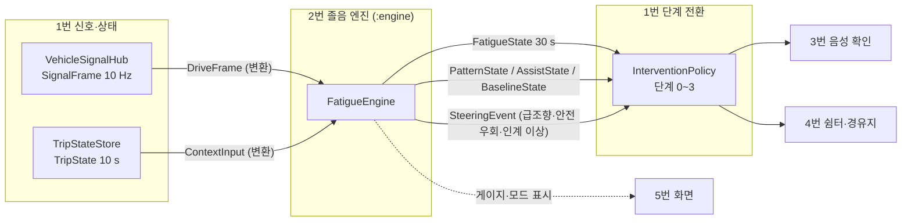
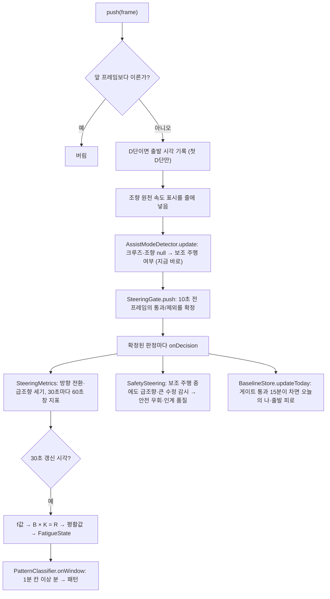

# 1. 2번이 하는 일과 전체 흐름

## 1-1. 앱 안에서 2번의 자리

CLAUDE.md 4장의 한 방향 흐름 **신호 수집 → 판단 → 개입 결정 → 실행** 가운데 '판단'의 조향 부분이다.

- 2번은 **숫자와 상태만 낸다.** 몇 단계로 올릴지, 언제 물어볼지, 쉼터를 넣을지는 1번 InterventionPolicy가 정한다.
- 2번 코드는 전부 `:engine`(순수 Kotlin) 안에 있다. Android·SDK·시계를 직접 부르지 않아서 `./gradlew :engine:test`로 에뮬레이터 없이 시험한다.
- ROS로 비유하면 FatigueEngine은 신호 토픽(10 Hz)을 구독해 점수 토픽(30 s)·패턴 토픽·보조 주행 토픽을 발행하는 **노드 하나**다. `push()`가 콜백이다.

## 1-2. 들어오는 것

| 입력 | 언제 | 주는 쪽 | 내용 |
| --- | --- | --- | --- |
| `DriveFrame` | 100 ms마다 `push(frame)` | 1번 SignalFrame·NaviState를 변환 (변환 함수는 PR #6 병합 뒤 추가) | 시각, 조향각(°), 차속(km/h), D단 여부, 방향지시등, 브레이크, 다음 회전 지점 거리(m), 크루즈 작동·설정 속도, 통풍 단계, 조향 원천이 5 Hz 이상인지 |
| `ContextInput` | 바뀔 때마다 `engine.context = …` | 1번 TripState + 앱(현지 시각) + 5번 설정(연령대) | 연속 운전(초), 최근 24시간 누적(초), 자정부터 센 분, 연령대, 동승자 수, 실내 온도 |
| 운행 기록 `List<BaselineRecord>` | 앱 시작 때 `baselineStore.loadHistory(…)` | Room(저장은 2차) | 지난 운행의 미세·큰 수정 분당 횟수, 깨어 있던 운행인지 |
| 출발 전 컨디션 | 고를 때 `baselineStore.reportCondition(sleepy, tMs)` | 5번 버튼 / 3번 말 | '졸려요'면 true |

`null`은 "이 신호를 지금 모른다"는 뜻이다. 엔진은 모르는 값을 0이나 false로 바꾸지 않는다. 조향·차속·기어·방향지시등·브레이크 가운데 하나라도 null이면 그 프레임은 게이트를 통과하지 못한다.

## 1-3. 나가는 것

| 출력 | 읽는 법 | 언제 바뀌나 | 받는 쪽이 쓰는 법 |
| --- | --- | --- | --- |
| `FatigueState` (MSG-02, 14필드) | `push()`의 반환 목록 | 30초마다 1개 | `valid`일 때만 `riskSmoothed`로 단계 판단(1번), 게이지 색(5번) |
| `PatternState` (MSG-03) | `engine.patternState` | 30초 갱신 때, 급조향 확인 때 | `patternType == TREND`면 추세형, `safetyBypass`면 바로 3단계 |
| `AssistState` (MSG-04) | `engine.assistState` | **프레임마다(지연 없음)** | `assistMode`면 정기 확인(1번), 게이지 회색(5번), `opGapSec`가 900 넘으면 확인 당김 |
| `BaselineState` (새 MSG-16 제안) | `engine.baselineState` | 값이 바뀔 때만 | `sensitive`면 문턱 30/50/70, `firstCheckDueMs`에 첫 음성 확인(1번), `departureFatigue`가 켜지는 순간 예보 재계산(4번) |
| `SteeringEvent` (새 메시지) | `engine.drainEvents()` | 사건이 생길 때 | 이름이 같은 1번 `SafetyEventType`으로 넘김 |

사건 3종:

| 사건 | 조건 | 1번이 할 일 |
| --- | --- | --- |
| `RAPID_STEERING` | 멈춤 뒤 급조향 1회 (보조 주행 중에는 안 냄) | 2단계 확인 (REQ_INT_002) |
| `REPEATED_RAPID_STEERING` | 5분 안 급조향 3회 (보조 주행 중에도 냄) | 원인 따지지 않고 3단계 (REQ_PAT_005) |
| `HANDOVER_UNSAFE` | 크루즈 해제 뒤 30초 안 급조향 또는 큰 수정 과다 | 2단계 (REQ_AST_007) |

## 1-4. 한 프레임이 지나가는 길

`push(frame)` 한 번에 일어나는 일 (코드: `fatigue/FatigueEngine.kt`):

순서대로 풀면:

1. **보조 주행 판정** (`AssistModeDetector`): 크루즈가 켜져 있으면 CRUISE, 조향 값이 null이면 UNCERTAIN, 아니면 일반. 이 판정만 지연 없이 그 프레임에서 바뀐다.
2. **게이트** (`SteeringGate`): 고속·D단·회전 지점에서 멀리·방향지시등 앞뒤 10초·브레이크 앞뒤 5초가 아닌 프레임만 통과. 방향지시등을 켜기 **10초 전** 프레임도 빼야 해서 프레임마다 10초 뒤를 보고 나서 확정한다.
3. **지표** (`SteeringMetrics`): 통과한 프레임으로 방향 전환(미세·큰 수정)과 멈춤 뒤 급조향을 센다. 처음 판정에서 60초 뒤부터 30초마다 최근 60초 창의 분당 횟수를 낸다.
4. **안전 감시** (`SafetySteering`): 같은 감지기를 보조 주행 조건만 빼고 한 벌 더 돌린다. 크루즈 중 급조향 3회(안전 우회)와 크루즈 해제 직후 거친 조향(인계 품질)을 놓치지 않기 위해서다.
5. **기준선** (`BaselineStore`): 게이트 통과 시간이 15분 쌓이는 순간 '오늘의 나'를 만들고, 그때 출발 피로를 한 번 판정한다.
6. **점수** (30초마다): 지표를 기준선과 비교해 f값 → B → K를 곱해 R → 3분 지수평균. 보조 주행 중이거나 통과 시간이 30초 미만이면 `valid = false`로 내고 평활값은 그대로 둔다.
7. **패턴** (`PatternClassifier`): 30초 창을 1분 칸으로 모아 이상 분을 세고 추세형·튐형·애매를 정한다.

## 1-5. 시간: 무엇이 10초 늦나

게이트가 판정을 10초 늦게 확정하므로, 판정 뒤에 오는 것은 모두 넣은 프레임보다 10초 늦다.

| 출력 | 지연 | 예 |
| --- | --- | --- |
| `FatigueState.tMs` | 10초 | 60초 시점 값은 70초 프레임을 넣을 때 나온다 |
| `SteeringEvent.tMs` | 10초 | 105.4초 급조향은 115.4초 프레임 때 꺼낼 수 있다 (시각은 105.4초로 찍힘) |
| `PatternState` | 10초 | 안전 우회는 3회째 급조향 10초 뒤에 켜진다 |
| `BaselineState` | 10초 | 처음부터 통과하면 오늘의 나·출발 피로는 910초 프레임에서 정해진다 |
| `AssistState` | **없음** | 크루즈를 켠 그 프레임에서 바뀐다 |

- 시간은 오직 **넣은 프레임의 `tMs`** 로 센다. `System.currentTimeMillis()`를 쓰지 않으므로 데모를 60배속으로 재생해도 계산은 같다 (1번 Clock이 시나리오 시각을 넣어 준다).
- 30초 갱신 시각은 처음 판정 시각에서 60초, 90초, 120초…로 맞춰진다. `reset()`하면 다시 맞춘다.

## 1-6. 하는 일과 하지 않는 일

| 2번이 한다 | 2번이 하지 않는다 (담당) |
| --- | --- |
| 조향 게이트, 지표 3개, f값, B·K·R, 3분 지수평균 | 단계 0~3 결정, 30초 한 칸 상승, 재알림 규칙 (1번 InterventionPolicy) |
| 기본값·평소의 나·오늘의 나 고르기, 출발 피로, 민감 모드 | 음성 확인과 '느림' 판정 (3번), 확인 결과에 따른 단계 변경 PAT_004·006·007 (1번) |
| 이상 분·추세형·튐형·애매, 안전 우회 신호 | 보조 주행 정기 확인 주기 20분·10분 AST_005, 조작 공백 15분 넘으면 확인 당김 (1번) |
| 보조 주행 판정, 인계 품질, 조작 공백 초 | 단위 변환 (1번 Hub가 km/h·m·°로 바꿔 줌, SIG_010) |
| 조향 원천이 5 Hz 미만일 때 미세 수정 끄기 | 원천 Hz 측정 자체 (1번 RateMeter) |
| | 운행 기록 저장(Room), 앱 재시작 뒤 복원 (1번·2차) |
