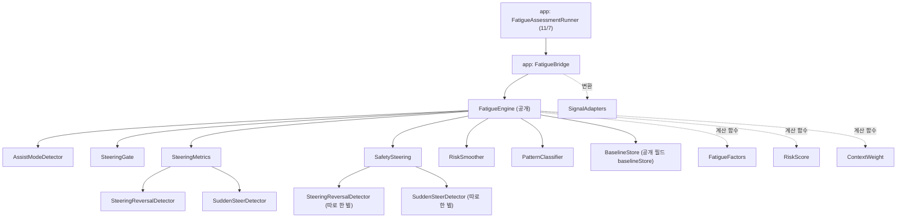

# 2. 코드 지도

경로 앞부분 `src/android/engine/src/main/java/com/sleepissue/awakedrive/engine/`는 줄여서 `engine/`으로 쓴다.
app 쪽 연결기 `src/android/app/src/main/java/com/sleepissue/awakedrive/fatigue/`는 `app/fatigue/`로 쓴다 (11/7 추가, [2-2 끝](#appfatigue--엔진-출력-연결기-117)).

## 2-1. 폴더 구조

```
engine/
├── config/      설정 묶음: 모든 숫자 문턱값 (코드 안에 숫자를 직접 쓰지 않음)
├── model/       모듈끼리 주고받는 data class (MSG-02·03·04·13 + 새 메시지)
├── fatigue/     게이트 → 지표 → 점수, 엔진 본체 FatigueEngine
├── baseline/    기준선: 기본값·평소의 나·오늘의 나, 출발 피로, 민감 모드
├── pattern/     이상 분·추세형·튐형·애매, 안전 우회
└── assist/      보조 주행 판정, 인계 품질, 조작 공백
```

`intervention/`, `forecast/`, `rest/`, `signal/`, `time/`, `check/`, `voice/`, `session/` 같은 다른 패키지는 1·3·4번 몫이다 (11/4에 PR #6·#7·#8로 main에 들어감).

## 2-2. 파일별 설명 (엔진 main 27개 2,534줄 + app 2개, 11/7 기준)

### config/ — 설정 묶음

| 파일 | 줄 | 하는 일 |
| --- | ---: | --- |
| `FatigueConfig.kt` | 147 | 게이트·창·지표 3개·f값·가중치·지수평균 문턱값 (`FatigueConfig`), 맥락 가중 K 문턱값 (`ContextWeightConfig`). `smoothingAlpha`(α = 1 − e^(−30/180) = 0.1535)는 시정수에서 계산. `EngineConfig.resolvedFatigueConfig()`는 팀 취약 시간대를 K에 넣은 묶음을 돌려줌 |
| `BaselineConfig.kt` | 60 | 기본 기준선 20/4 [가정], 평소의 나 3회·10회, 오늘의 나 15분, 출발 피로 조건, 첫 확인 15분, 5 Hz 미만 비율 10% [제안값], 큰 수정 하한 2/분 [제안값] |
| `PatternConfig.kt` | 35 | 이상 분 0.70·1.5배, 10분 돌아보기, 추세형 6·튐형 3, 복귀 1분, 안전 우회 3회·5분·유지 5분 |
| `AssistConfig.kt` | 25 | 인계 감시 30초, 1.5배, 기록 없으면 3회. 매끈한 조향(2차) 값 |
| `VulnerableTimeDefaults.kt` | 27 | 취약 시간대 기본값 한 곳 (기본 02~07·14~17시, 연령대별). 팀 `EngineConfig`와 `ContextWeightConfig`가 같이 씀 (11/7) |

팀 공통 `EngineConfig`(1번이 만든 본체, 11/4 main)에 2번 묶음 4개를 `fatigue`·`baseline`·`pattern`·`assist` 칸으로 붙였다 (11/7). 앱은 `FatigueEngine(EngineConfig)`로 만든다. 11/4까지 쓰던 임시 `HourWindow`·`AgeGroup`은 4번 `VulnerableTimeRange`·`AgeBand`로 바꾸며 지웠다.

### model/ — 주고받는 자료

| 파일 | 줄 | 하는 일 |
| --- | ---: | --- |
| `DriveFrame.kt` | 36 | **2번 입력** 한 프레임. 1번 SignalFrame 병합 뒤 변환 함수로 채움 |
| `FatigueState.kt` | 64 | **MSG-02** 30초 결과 14필드 + `InvalidReason{NONE, GATE_WAIT, ASSIST}`. 14번째 `microEnabled`는 새로 추가 제안 |
| `PatternState.kt` | 37 | **MSG-03** 이상 분 수, `PatternType{NONE, TREND, SPIKE, AMBIGUOUS}`, 안전 우회 |
| `AssistState.kt` | 32 | **MSG-04** 보조 주행 여부, `AssistReason{NONE, CRUISE, SMOOTH_STEERING, UNCERTAIN}`, 인계 이상, 조작 공백 초 |
| `BaselineRecord.kt` | 25 | **MSG-13** 운행 하나의 기준선 기록 (Room 저장용 원본, 저장 자체는 2차) |
| `BaselineState.kt` | 47 | **새 메시지(MSG-16 제안)** 기준선 출처·값, 오늘의 나, 출발 피로, '졸려요', 민감 모드 시작·첫 확인 시각. `BaselineSource{DEFAULT, USUAL, TODAY}` |
| `SteeringBaseline.kt` | 17 | 비교 기준 한 쌍(미세/분, 큰/분). 음수 금지 |
| `SteeringEvent.kt` | 20 | **새 메시지** 바로 반응해야 하는 사건 3종. 1번 `SafetyEventType`과 이름을 맞춤 |

### fatigue/ — 게이트·지표·점수·엔진

| 파일 | 줄 | 하는 일 |
| --- | ---: | --- |
| `SteeringGate.kt` | 234 | 게이트 (FAT_001~004). `GateInput` → 10초 뒤 `GateDecision(tMs, 조향각, reason, reasonWithoutAssist)`. 이유 9가지 `GateReason` |
| `SteeringReversalDetector.kt` | 85 | 조향각 흐름에서 방향이 바뀐 점(극값)을 찾아 극값 사이 크기를 돌려줌. 0.5° 되돌아와야 방향 전환으로 인정 (`internal`) |
| `SuddenSteerDetector.kt` | 93 | 멈춤 뒤 급조향 (FAT_008) (`internal`) |
| `SteeringMetrics.kt` | 202 | 60초 창·30초 갱신 지표 (FAT_005~008). `SteeringIndicators` 반환. 오늘의 나용 누적 합계도 셈. `windowEndingAt(t)`는 급조향까지의 60초를 상태를 바꾸지 않고 계산 (11/7) |
| `FatigueFactors.kt` | 39 | f미세·f큰·f급조향 (FAT_009~011) |
| `ContextWeight.kt` | 109 | 맥락 가중 K (FAT_013~018). `ContextInput`(입력, 연령대는 `AgeBand?`), `ContextFactors`(켜진 항목), 취약 시간대 판단 |
| `RiskScore.kt` | 50 | B·R (FAT_012·019), 미세 수정을 뺀 B 재정규화 (SIG_009) |
| `RiskSmoother.kt` | 38 | 3분 지수평균 (FAT_020) |
| `SafetySteering.kt` | 61 | 보조 주행 중에도 급조향·큰 수정을 보는 두 번째 감지기 (PAT_005·AST_007) (`internal`) |
| `FatigueEngine.kt` | 323 | **2번 전체를 묶는 본체.** 다른 모듈은 이 클래스만 쓰면 된다. 앱은 `FatigueEngine(EngineConfig)` |
| `SignalAdapters.kt` | 63 | 1번 `SignalFrame`·`NaviState`·`TripState` → `DriveFrame`·`ContextInput` 변환, 5 Hz 판정, 동승자 수 (11/7) |

### baseline/ · pattern/ · assist/

| 파일 | 줄 | 하는 일 |
| --- | ---: | --- |
| `baseline/BaselineStore.kt` | 253 | 기준 고르기, 평소의 나 중앙값, 오늘의 나 확정, 출발 피로, 민감 모드, 첫 확인 시각 (BSL_001·003~007). 비교 기준 큰 수정 하한 `comparable` (11/7) |
| `pattern/PatternClassifier.kt` | 237 | 1분 칸 이상 분, 추세형·튐형·애매, 안전 우회 (PAT_001~003·005). 급조향 칸 `onSuddenWindow` (11/7) |
| `assist/AssistModeDetector.kt` | 175 | 보조 주행 판정, 인계 감시, 조작 공백 (AST_001·003·004·006·007·008) |

### app/fatigue/ — 엔진 출력 연결기 (11/7)

| 파일 | 줄 | 하는 일 |
| --- | ---: | --- |
| `FatigueBridge.kt` | 186 | 계산 부분. Hub 프레임 → 엔진 → 1번 `InterventionInput`(Assessment·Safety·민감 모드·취약 시간대). 대응 함수 `toDrivingAssessment`·`toDrivingPattern`·`toSafetyEvent`, 화면용 `FatigueSnapshot` |
| `FatigueAssessmentRunner.kt` | 116 | 실행 부분. Hub `samples`를 모아 Bridge를 돌리고 1번 `InterventionManager.submit`으로 넣음. 1번 `DrivingAssessmentSource` 구현, `snapshots` StateFlow |

1번 `SignalPorts.kt`·`InterventionManager.kt` 계약만 쓰고 Android API는 쓰지 않는다. 설명은 [03 3-16](03-algorithms.md#3-16-엔진-출력-연결기-app--fatiguebridge).

## 2-3. 클래스 관계



- `FatigueEngine`이 나머지를 모두 만들어 들고 있다. 다른 모듈은 `FatigueEngine` 하나만 만들면 된다. 앱에서는 연결기(`FatigueAssessmentRunner` → `FatigueBridge`)가 만들고 부른다.
- `FatigueFactors`·`RiskScore`·`ContextWeight`는 상태가 없는 계산 함수 모음(`object`)이라 시험에서 따로 불러 쓸 수 있다.
- 감지기를 두 벌 둔 이유: 점수용(`SteeringMetrics`)은 보조 주행 중 프레임을 빼야 하고, 안전 감시용(`SafetySteering`)은 넣어야 해서 상태를 따로 가져야 한다.

## 2-4. 다른 모듈이 쓰는 법 (공개 API)

```kotlin
val engine = FatigueEngine(EngineConfig())            // 앱. 값을 바꾸려면 EngineConfig(fatigue = FatigueConfig(gateMinSpeedKph = 50f))
engine.baselineStore.loadHistory(records)             // 앱 시작 때 지난 운행 기록 (BSL_001·003)
engine.baselineStore.reportCondition(sleepy, nowMs)   // 출발 전 컨디션 (BSL_007)
engine.context = ContextInput(continuousDriveSec = …, last24hDriveSec = …,
    minuteOfDay = …, ageBand = …, passengerCount = …, cabinTempC = …)    // 바뀔 때마다 (연결기는 contextInputOf로)

val states: List<FatigueState> = engine.push(frame)   // 100 ms마다. 30초마다 1개, 나머지는 빈 목록
val events: List<SteeringEvent> = engine.drainEvents() // push 뒤마다. 꺼낸 사건은 지워짐(최대 100개 보관)
engine.baselineState   // source, reference, today, departureFatigue, reportedSleepy, sensitive, sensitiveSinceMs, firstCheckDueMs
engine.patternState    // abnormalMinutes10m, patternType, safetyBypass
engine.assistState     // assistMode, reason, handoverAbnormal, opGapSec

engine.flush()               // 운행 끝: 게이트에 남은 10초를 확정해 마지막 갱신까지 냄
engine.reset()               // 새 운행 (꺼져 있던 시간 2시간 초과, TRP_008)
engine.resetRiskAfterRest()  // 휴식 인증 + 회복 확인 뒤 (RES_011)
```

- **한 스레드(코루틴 하나)에서만** 부른다. 안에 잠금(lock)이 없다. 앱에서는 연결기 `FatigueAssessmentRunner`가 이 규칙을 지켜 준다.
- 상태 객체(`baselineState`·`patternState`·`assistState`)는 값이 바뀔 때만 새 객체가 된다. Kotlin `StateFlow`에 그대로 넣으면 바뀔 때만 알림이 간다.

### 초기화 범위

| 들고 있는 것 | `reset()` (새 운행) | `resetRiskAfterRest()` (휴식 뒤) |
| --- | --- | --- |
| 게이트 대기 프레임, 방향지시등·브레이크 기억, 5분 유지 | 지움 | 유지 |
| 지표 창, 오늘의 나용 누적 합계 | 지움 | 유지 |
| 평활값 | 0 | **0** |
| 오늘의 나, 출발 피로, '졸려요', 출발 시각 | 지움 | 유지 (RES_011 "기준선 불변") |
| 평소의 나, 평소 인계 횟수 (`loadHistory`) | 유지 | 유지 |
| 이상 분·패턴·안전 우회 | 지움 | 유지 |
| 보조 주행·인계 감시·조작 공백 | 지움 | 유지 |
| 꺼내지 않은 사건, 5 Hz 표시 | 지움 | 유지 |
| `context`(맥락) | 유지 | 유지 |

## 2-5. 시험 파일 (엔진 test 15개 2,059줄, 시험 125개 + app 1개 8개, 11/7 기준)

| 파일 | 시험 수 | 무엇을 |
| --- | ---: | --- |
| `config/FatigueConfigTest.kt` | 11 | 설정 기본값이 SRS 숫자와 맞는지, 팀 EngineConfig와 같은 취약 시간대·묶음 |
| `fatigue/SteeringGateTest.kt` | 13 | 게이트 경계값 |
| `fatigue/SteeringReversalDetectorTest.kt` | 4 | 미세·큰 수정 경계 |
| `fatigue/SuddenSteerDetectorTest.kt` | 5 | 급조향 경계 |
| `fatigue/SteeringMetricsTest.kt` | 8 | 창·갱신·분당 환산, 급조향까지의 60초 창 |
| `fatigue/FatigueFactorsTest.kt` | 4 | f값 |
| `fatigue/ContextWeightTest.kt` | 9 | K, 연령대별 취약 시간대 |
| `fatigue/RiskScoreTest.kt` | 5 | B·R |
| `fatigue/RiskSmootherTest.kt` | 3 | 지수평균 |
| `fatigue/FatigueEngineTest.kt` | 24 | 엔진 전체 흐름 (시나리오 시험), EngineConfig 생성자, 딴짓 시작 시각, 큰 수정 하한 |
| `fatigue/SignalAdaptersTest.kt` | 6 | 1번 신호 → 2번 입력 변환 |
| `baseline/BaselineStoreTest.kt` | 13 | 기준선·출발 피로·민감 모드, 큰 수정 하한 |
| `pattern/PatternClassifierTest.kt` | 12 | 이상 분·패턴·안전 우회, 급조향 칸 |
| `assist/AssistModeDetectorTest.kt` | 8 | 보조 주행·인계·조작 공백 |
| `fatigue/SteeringTestPaths.kt` | — | 시험용 조향 경로를 만드는 도우미 (삼각파 등) |
| app `fatigue/FatigueBridgeTest.kt` | 8 | 연결기 대응표, 30초 판단·사건·민감 모드·취약 시간대 보내기, 요청 ID |

목록과 REQ 대응은 [06-testing.md](06-testing.md).

## 2-6. Kotlin 읽는 법 (이 코드에 나오는 것만)

| 보이는 것 | 뜻 |
| --- | --- |
| `data class FatigueState(val tMs: Long, …)` | 값만 담는 클래스. `==`가 필드 비교, `copy(…)`로 일부만 바꾼 새 값 |
| `val` / `var` | 바꿀 수 없는 값 / 바꿀 수 있는 값 |
| `Float?` | null일 수 있는 Float. `x ?: 0f`는 "x가 null이면 0f" |
| `x?.let { … }` | x가 null이 아닐 때만 블록 실행 |
| `when { 조건 -> 값 … }` | if-else 사슬 |
| `object RiskScore { … }` | 하나만 있는 객체(정적 함수 모음 같은 것) |
| `companion object { … }` | 클래스에 붙은 정적 멤버 (`BaselineStore.usualOf(…)`처럼 부름) |
| `internal` | 같은 모듈(`:engine`) 안에서만 보임. 시험은 같은 모듈이라 볼 수 있음 |
| `var state … private set` | 밖에서 읽기만, 쓰기는 안에서만 |
| `fun FatigueConfig.swingClassOf(a: Double)` | 확장 함수: `config.swingClassOf(2.0)`처럼 부름 |
| `5 * 60_000L`, `0.35f` | `_`는 자릿수 구분, `L`은 Long, `f`는 Float |
| `require(조건) { "메시지" }` | 조건이 거짓이면 예외 (잘못된 입력 막기) |
| `coerceIn(0f, 1f)` | 0~1로 자르기 (clamp) |
| `ArrayDeque` | 앞뒤로 넣고 빼는 큐. 시간 창에서 오래된 것을 앞에서 버릴 때 씀 |
| `@Test fun 이름() { assertEquals(기대, 실제, 허용오차) }` | JUnit 4 시험 하나 |
