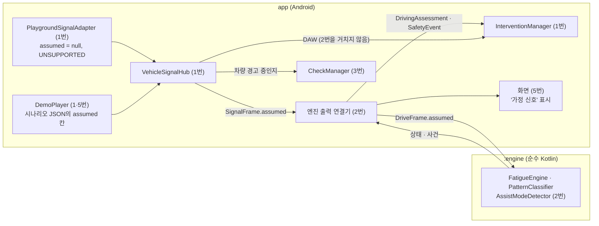

# 10. 2차 확장 설계 — 가정 신호(LFA·LKA·핸즈온·DAW)를 시나리오로 넣기

> **상태: 설계만 했다.** 구현은 MVP 동결(11/10) 뒤 2차(11/16~)에 한다. 1차 코드와 1차 제출물(11/15)은 바꾸지 않는다.
> 근거: 기획서 v4 확장가정(E1~E3: 4-3·4-4·5-2·5-3·5-4·6장·15장), Pleos 메일 답변(11/5), CLAUDE.md 4·7·9장
> 이 문서는 2번 엔진 쪽 설계가 중심이다. 1·3·5번이 바꿀 곳은 [6절](#6-다른-담당에-부탁할-것)에 따로 적었다.

## 1. 왜 하나

- **실제로는 못 받는다.** 11/5 Pleos 답변: ADAS SDK는 쓸 수 없다. 공모전 자료는 Playground 공개 문서가 전부이고, 따로 승인받는 절차도 없다. 그래서 LFA·LKA 상태, LKA 개입, 차로 이탈 경고, 핸즈온, 차량 DAW, 주의 분산 경고는 지금 앱이 받을 수 없다.
  - 같은 답변에 "개별 신호를 다른 경로로도 받을 수 없다는 뜻은 아니다"라는 단서가 있다. 다른 경로는 2차 초에 한 번 확인한다 ([9절](#9-실제-경로-확인-선택-2차-초)).
- **규칙은 이미 있다.** 확장 가정 기획서가 이 신호들이 열린다고 가정하고 판단 규칙을 정해 두었다.
- **2차 PT에서 동작으로 보여 주려면** 같은 판단 코드에 이 신호를 넣어 볼 길이 필요하다. "SDK가 열리면 이렇게 붙는다"를 말이 아니라 화면으로 보여 줄 수 있다.
- **방법:** 이미 있는 '신호 공급원 — 실제/데모 두 구현' 구조에 칸 하나를 더한다. 실제 쪽은 늘 비워 두고(미지원), 데모 쪽은 시나리오 JSON에서 채운다. ROS로 치면 실제 센서 노드가 없어서 bag 파일 재생 노드가 같은 토픽에 값을 내보내는 것과 같다.

> 채팅에서 처음 말한 `LaneAssistSource` 같은 기능별 인터페이스는 쓰지 않기로 했다. 1번 Hub가 이미 실제(`PlaygroundSignalAdapter`)와 데모(`DemoPlayer`)를 같은 `VehicleSignalSource`로 받으므로, 칸을 더하는 쪽이 움직이는 부분이 적다.

## 2. 지킬 것

| # | 규칙 | 이유 |
| --- | --- | --- |
| 1 | 이름은 우리 것으로 짓고 `Assumed`(가정)로 시작한다. Pleos SDK의 클래스·메서드 이름을 흉내 내지 않는다 | CLAUDE.md 7장. 없는 API를 있는 것처럼 보이게 하면 안 된다 |
| 2 | 실제 어댑터는 이 칸을 늘 `null`로 두고 품질은 `UNSUPPORTED`로 표시한다 | 메일 답: 지금 받을 길이 없다 |
| 3 | 값은 데모 시나리오(`Source.DEMO`)에서만 나오고, 실제 신호와 같은 VehicleSignalHub로 들어간다 | CLAUDE.md 4장. 데모도 실제와 같은 판단 로직을 거친다 |
| 4 | 칸이 `null`(모름)이면 엔진 출력은 지금(1차)과 한 글자도 다르지 않다 | 기획서 확장가정 서두: "가정이 틀리면 그 기능만 현재 기능 동작으로" |
| 5 | 화면·영상·README에 "가정 신호(시뮬레이션)"를 표시한다 | CLAUDE.md 9장 '데모 재생 중' 표시와 같은 취지. 심사에서 실제 차량 값처럼 보이면 안 된다 |
| 6 | 새 숫자는 모두 설정(EngineConfig 묶음)에 두고 근거가 없으면 `[가설]`을 단다 | CLAUDE.md 4장 |

## 3. 구조



- 2번이 쓰는 것: LFA 상태, LKA 개입, 차로 이탈 경고, 핸즈오프 경고, 주의 분산 경고.
- 2번이 쓰지 않는 것: 차량 DAW 주의 수준·휴식 경고. 단계로 바로 가는 규칙이라 1번 단계 전환이 Hub에서 직접 읽는다 ([6절](#6-다른-담당에-부탁할-것)).
- E4(시트·핸들 진동)는 출력 쪽(1·3번)이라 이 문서 범위 밖이다.

## 4. 신호 정의

```kotlin
// engine/model/AssumedSignals.kt — 우리가 정한 이름이다 (Pleos API 아님)
/**
 * 확장 가정(E1~E3) 신호 묶음. 지금 Pleos SDK로는 받을 수 없어(11/5 메일 답변) 데모 시나리오에서만 채운다.
 * null = 모름 → 엔진은 1차 동작 그대로. 이벤트는 '누적 횟수'로 받는다.
 */
data class AssumedSignals(
    val laneAssist: LaneAssistStatus? = null,  // E1 LFA 상태
    val lkaInterventions: Int? = null,         // E1 LKA 조향 보정 누적 횟수
    val laneDepartureWarnings: Int? = null,    // E1 차로 이탈 경고 누적 횟수
    val handsOn: Boolean? = null,              // E2 운전대를 잡고 있는지
    val handsOffWarnings: Int? = null,         // E2 핸즈오프 경고 누적 횟수
    val dawLevel: DawLevel? = null,            // E3 차량 DAW 주의 수준 (1번이 읽음)
    val dawRestWarnings: Int? = null,          // E3 DAW 휴식 권장 경고 누적 횟수 (1번이 읽음)
    val distractionWarnings: Int? = null,      // E3 주의 분산 경고 누적 횟수
)

/** 기획서 15장 Q1의 구분을 그대로 옮김 */
enum class LaneAssistStatus { OFF, STANDBY, ACTIVE, DRIVER_OVERRIDE, AUTO_RELEASED }

enum class DawLevel { NORMAL, ATTENTION_LOW }
```

| 칸 | 뜻 | 기획서 | 받는 쪽 |
| --- | --- | --- | --- |
| `laneAssist` | 꺼짐 / 켜짐·대기(차선 못 찾음) / 작동(조향 개입 중) / 운전자 조작으로 잠깐 해제 / 경고 뒤 자동 해제 | 5-4, Q1 | 2번 보조 주행 판정 |
| `lkaInterventions` | LKA가 조향을 보정한 횟수 | 4-4, Q2 | 2번 게이트·차로 이탈 지표 |
| `laneDepartureWarnings` | 차로 이탈 경고가 울린 횟수 | 4-4, Q2 | 2번 차로 이탈 지표 |
| `handsOn`, `handsOffWarnings` | 운전대를 잡고 있는지, 핸즈오프 경고 횟수 | 5-4, Q3 | 2번 보조 주행 중 판단 |
| `dawLevel`, `dawRestWarnings` | 차량 졸음 경고의 주의 수준, 휴식 권장 경고 횟수 | 6장, Q4 | 1번 단계 전환, 3번 동승자 확인 |
| `distractionWarnings` | 주의 분산(전방 주시 태만) 경고 횟수 | 5-2, Q5 | 2번 딴짓 분류 |

**이벤트를 '누적 횟수'로 받는 이유.** Hub는 100 ms마다 칸별 '최신 값'을 묶어 보낸다. 경고를 한 프레임짜리 true로 보내면 다음 값에 덮여 사라지거나, 같은 경고를 두 번 셀 수 있다. 누적 횟수로 보내면 받는 쪽은 직전 값과의 차이로 몇 번 울렸는지 정확히 안다. ROS 메시지 header의 `seq` 번호와 같은 생각이다. 횟수가 줄어들면(시나리오가 바뀜, 출처 전환) 새로 시작한 것으로 보고 그 차이는 세지 않는다 [해석].

## 5. 엔진(2번)에서 바뀌는 것

### 5-1. 입력

- `DriveFrame`에 `assumed: AssumedSignals? = null`을 더한다. 기본값이 `null`이라 지금 시험(2번 104개, 팀 엔진 전체)은 손대지 않아도 그대로 돈다.
- 변환 함수(`SignalFrame.toDriveFrame`)는 `assumed`를 그대로 넘긴다. 단위 변환은 없다.

### 5-2. 보조 주행 판정 (AssistModeDetector, 기획서 5-4)

| `laneAssist` | 판정 | 이유 |
| --- | --- | --- |
| `null` (모름, 1차) | 지금대로: 크루즈 작동 → 보조 주행(`CRUISE`) | 규칙 4 |
| `ACTIVE` | 보조 주행, 새 이유 `LANE_ASSIST` | 차가 조향을 돕는 동안은 운전자 조향 습관이 안 드러난다 |
| `OFF`·`STANDBY`·`DRIVER_OVERRIDE`·`AUTO_RELEASED` | 보조 주행 아님. **크루즈가 켜져 있어도** 조향을 계산한다 | 기획서 5-4: "크루즈만 켜진 경우에는 사람이 조향하므로 조향 지표를 그대로 씁니다" |
| (어느 경우든) 조향 값 `null` | `UNCERTAIN` 그대로 | REQ_AST_003 |

- 인계 감시(30초, REQ_AST_007)는 `LANE_ASSIST` → 아님으로 바뀔 때도 시작한다. 손을 안 잡아서 LFA가 스스로 꺼진 `AUTO_RELEASED`도 여기서 잡힌다 (기획서 5-4의 6번).
- `laneAssist`를 알면 크루즈는 보조 주행 판정에 쓰지 않는다. 조작 공백(크루즈 설정 속도 변경)에는 계속 쓴다.

### 5-3. LKA 개입 순간 빼기 (게이트, 기획서 4-3)

- LKA가 보정한 순간의 조향은 사람이 한 것이 아니다. `lkaInterventions`가 늘어난 시각의 **앞 2초 ~ 뒤 3초**를 게이트에서 뺀다 [가설]. 새 게이트 이유 `LKA_INTERVENTION`.
- 지금 게이트는 방향지시등 때문에 10초 늦게 확정하므로, 앞 2초를 거슬러 빼는 데 구조 변경이 필요 없다.
- 점수 계산과 안전 감시(급조향 3회·인계 품질) **둘 다**에서 뺀다. 기계가 꺾은 것을 급조향으로 세면 안 되기 때문이다.

### 5-4. 차로 이탈 지표 (기획서 4-4)

- 최근 15분의 차로 이탈 경고 + LKA 개입 횟수를 센다 (`laneEvents15m`).
- 이벤트가 있었던 1분 칸은 '이상 분'으로 센다 (기획서 5-2). 단, 조향을 계산한 칸에만 표시한다. 보조 주행 중인 칸은 지금처럼 '측정 안 한 칸'으로 두고 아래 15분 규칙만 쓴다 [해석].
- 15분에 2회 이상이면 2단계 확인 사건 `LANE_DEPARTURE_REPEATED`를 낸다 (1번 `SafetyEventType`에 추가 부탁). 추세형과 겹치면 3단계로 가는 판단은 1번 단계 전환이 한다 (기획서 6장 표).
- 위험 점수 식(B)은 바꾸지 않는다. 기획서 4-5 식에 차로 이탈 항이 없다.

### 5-5. 주의 분산 경고 (기획서 5-2)

기획서 규칙: "차량이 주의 분산 경고를 낸 1분 안의 조향 이상은 딴짓으로 바로 분류합니다. 졸음 점수에서 빼고 따로 질문하지 않습니다. 안전 우회는 그대로 씁니다."

- 경고 시각의 **앞 10초 ~ 뒤 50초**(합쳐 1분)를 '딴짓 구간'으로 표시한다 [가설]. 앞 10초는 지금 게이트의 10초 소급 범위 안이다.
- 그 구간은 지금 보조 주행이 쓰는 길을 그대로 탄다: **점수에서는 빼고 안전 감시는 계속한다** (`GateDecision.passedWithoutAssist`와 같은 방식, 새 게이트 이유 `DISTRACTION_WARNING`).
  - 졸음 점수(B)에 들어가지 않는다.
  - 그 구간의 급조향은 2단계 확인 사건(`RAPID_STEERING`)을 내지 않는다. 점수 쪽 길에서만 나오는 사건이라 저절로 막힌다.
  - 안전 우회(5분 안 급조향 3회, `REPEATED_RAPID_STEERING`)에는 센다. 안전 감시 길은 그대로 돌기 때문이다.
- 그 1분 칸은 이상 분도 회복도 아닌 칸으로 두고, `PatternState.distractionFlagged = true`를 낸다. 1번이 이것으로 "딴짓 1건"을 기록한다 (REQ_PAT_004의 '기록' 부분. 1차에는 이 기록을 만드는 곳이 없다).

### 5-6. 핸즈오프 경고 증가 (기획서 5-4)

- 보조 주행 중에만 센다. 최근 15분 핸즈오프 경고가 **2회 이상**이면서 **평소의 2배 이상**이면 `AssistState.handsOffSurge = true`, 사건 `HANDS_OFF_SURGE`를 한 번 낸다 → 1번이 다음 확인을 바로 당긴다(2단계).
- 평소 = 보조 주행 1시간당 핸즈오프 경고 수. 운행 기록(BSL_002, 2차)에 칸을 더해 중앙값으로 만든다. 기록 3회 전에는 기본값 1회/시간 [가설]을 쓴다. 15분 기대치가 0.25회라 '2배 이상'은 0.5회이고, 이때는 사실상 '15분 2회 이상' 조건만 남는다.
- 기획서대로 절대 횟수만 보지 않는다. 매뉴얼상 운전대를 약하게 잡아도 경고가 뜰 수 있어서다.

### 5-7. 출력이 바뀌는 것 (메시지 변경 제안)

| 메시지 | 바뀌는 것 | 기본값 | 받는 쪽 |
| --- | --- | --- | --- |
| MSG-04 AssistState | `reason`에 `LANE_ASSIST` 추가, `handsOffSurge: Boolean` 추가 | `false` | 1번(확인 당김), 5번(표시) |
| MSG-03 PatternState | `laneEvents15m: Int`, `distractionFlagged: Boolean` 추가 | `0`, `false` | 1번, 5번 |
| 엔진 사건 → 1번 `SafetyEventType` | `LANE_DEPARTURE_REPEATED`, `HANDS_OFF_SURGE` 추가 | — | 1번 |
| `DriveFrame` (2번 내부) | `assumed` 추가 | `null` | 2번 |

기본값이 모두 1차 동작과 같으므로, 받는 쪽은 새 칸을 안 읽어도 1차처럼 돈다.

### 5-8. 새 설정값

| 이름 | 값 | 표시 | 묶음 |
| --- | --- | --- | --- |
| `lkaExcludeBeforeMs` / `lkaExcludeAfterMs` | 2,000 / 3,000 | [가설] | FatigueConfig |
| `distractionWindowBeforeMs` / `distractionWindowAfterMs` | 10,000 / 50,000 | [가설] (기획서 '1분'을 나눈 것) | FatigueConfig |
| `laneEventWindowMs` / `laneEventCheckCount` | 900,000 / 2 | 기획서 4-4 | PatternConfig |
| `handsOffWindowMs` / `handsOffMinCount` / `handsOffUsualRatio` | 900,000 / 2 / 2.0 | 기획서 5-4 | AssistConfig |
| `handsOffDefaultPerAssistHour` | 1.0 | [가설] | AssistConfig |

## 6. 다른 담당에 부탁할 것

| 담당 | 할 일 | 기획서 |
| --- | --- | --- |
| 1번 | `VehicleSignalInput`·`SignalFrame`에 `assumed` 칸 하나(SignalField 하나). 실제 어댑터는 늘 `null`·`UNSUPPORTED`. 데모 재생 중에 데모 값이 쓰이도록 중재 규칙 확인 | 4장 원칙 |
| 1번 | `SafetyEventType`에 `LANE_DEPARTURE_REPEATED`(→ 2단계, 그때 추세형이면 3단계), `HANDS_OFF_SURGE`(→ 2단계) | 6장 표 |
| 1번 | DAW 규칙: `ATTENTION_LOW` → 2단계, 휴식 경고 → 3단계. 차량 경고가 끝나고 3초 뒤 쉼터 경유지 제안, 같은 말 겹치지 않기 | 6장 'DAW 휴식 경고 이어받기' |
| 1번 | `distractionFlagged`로 딴짓 기록 남기기 (Room 운행 기록) | 5-2 |
| 3번 | 차량 경고(경고 횟수가 늘어난 순간)가 있으면 음성 확인을 3초 뒤로 미루기 [가설: 경고 길이를 모르므로 늘어난 시각 기준] | 4-3 |
| 3번 | 대화 중이어도 추세형이나 DAW 주의 저하면 바로 동승자 확인 | 5-3 |
| 5번 | '데모 재생 중' 옆에 '가정 신호' 표시. 가정 신호로 올라간 단계는 원인 문구에도 "(가정)" | 규칙 5 |
| 5번 | 시나리오 JSON에 `assumed` 칸, 확장 시나리오 합성 (아래 7절) | — |

## 7. 시나리오 JSON

1차 시나리오 형식(MSG-11, 간트 [7])은 아직 확정 전이다. **지금 부탁할 것은 하나뿐이다:** 형식을 정할 때 행마다 선택 칸 `assumed`가 들어올 자리를 남기고, 1차 파서는 모르는 칸을 무시하게 만든다(예: kotlinx.serialization `ignoreUnknownKeys = true`). 그러면 2차 시나리오 파일을 1차 앱이 읽어도 깨지지 않는다. 칸 이름은 확정되는 MSG-11 형식을 따른다. 아래는 모양만 보여 주는 예다.

```json
{
  "scenarioId": "ext_lfa_handover",
  "assumedSignals": true,
  "frames": [
    { "tMs": 600000, "steeringDeg": 0.4, "speedKph": 98, "gear": "D", "cruiseActive": true,
      "assumed": { "laneAssist": "ACTIVE", "handsOn": true, "handsOffWarnings": 0 } },
    { "tMs": 1500000, "steeringDeg": 0.2, "speedKph": 98, "gear": "D", "cruiseActive": true,
      "assumed": { "laneAssist": "AUTO_RELEASED", "handsOn": false, "handsOffWarnings": 3 } }
  ]
}
```

2차에 더할 시나리오 후보:

| # | 이름 | 흐름 | 보여 주는 것 |
| --- | --- | --- | --- |
| 1 | LFA 인계 | LFA 작동 → 핸즈오프 경고 3회/15분 → 자동 해제 → 30초 안 급조향 | 보조 주행 확정, 핸즈오프 증가, 인계 품질 → 2단계 |
| 2 | 차로 이탈 + 졸음 | 졸음 추세형 진행 중 차로 이탈 경고 2회/15분 | 2단계 → 추세형과 겹쳐 3단계 |
| 3 | 주의 분산 | 주의 분산 경고 + 급조향 1회 | 질문 없이 딴짓 기록. 급조향 3회면 안전 우회 |
| 4 | DAW 휴식 경고 | DAW 주의 저하 → 휴식 경고 | 2단계 → 3초 뒤 쉼터 제안 (1번) |

## 8. 시험 계획 (2번)

- **회귀가 먼저다:** `assumed = null`이면 지금 시험이 모두 통과하고, [05](05-behavior.md)의 시나리오 A~G 출력 숫자가 그대로여야 한다.

| # | 시험 이름 (안) | 확인하는 것 |
| --- | --- | --- |
| 1 | `nullAssumedSignalsKeepFirstPhaseOutputs` | 위 회귀 |
| 2 | `laneAssistUnknownKeepsCruiseRule` | `null`이면 크루즈 → 보조 주행 |
| 3 | `laneAssistActiveIsAssistEvenWithoutCruise` | `ACTIVE` → `LANE_ASSIST` |
| 4 | `cruiseWithLaneAssistOffStillScoresSteering` | 크루즈만 켜짐 → 조향 계산 |
| 5 | `autoReleaseStartsHandoverWatch` | `AUTO_RELEASED` → 30초 인계 감시 |
| 6 | `lkaInterventionExcludesTwoSecondsBeforeAndThreeAfter` | 경계 1.9 s·2.0 s, 2.9 s·3.0 s |
| 7 | `lkaSteeringDoesNotCountAsSuddenOrHandover` | 안전 감시에서도 뺌 |
| 8 | `laneEventMarksMeasuredMinuteAbnormal` | 이상 분 표시 |
| 9 | `laneEventsDuringAssistCountButDoNotMarkMinutes` | 보조 주행 중에는 15분 규칙만 |
| 10 | `twoLaneEventsInFifteenMinutesEmitLaneDepartureRepeated` | 1회 → 없음, 2회 → 사건 1번, 15분 지나면 빠짐 |
| 11 | `distractionWindowIsExcludedFromScore` | B에 안 들어감 |
| 12 | `distractionWindowSuppressesRapidSteeringEvent` | 2단계 확인 사건 없음 |
| 13 | `distractionWindowStillCountsTowardSafetyBypass` | 급조향 3회 → 안전 우회 |
| 14 | `handsOffSurgeNeedsTwoInFifteenMinutesAndTwiceUsual` | 1회 → 아님, 2회 → 맞음, 평소가 높으면 아님 |
| 15 | `counterDecreaseIsTreatedAsReset` | 횟수가 줄면 세지 않음 |

새 규칙도 1차처럼 돌연변이 시험(규칙을 일부러 틀리게 바꿔 시험이 잡는지)으로 확인한다 ([06](06-testing.md)).

## 9. 실제 경로 확인 (선택, 2차 초)

- 메일 답변의 단서("다른 경로로도 받을 수 없다는 뜻은 아님") 때문에 1번이 30분 정도 확인해 볼 만하다: AAOS `CarPropertyManager`에서 `LANE_CENTERING_ASSIST_STATE`·`LANE_KEEP_ASSIST_STATE`·`HANDS_ON_DETECTION_DRIVER_STATE`·`HANDS_ON_DETECTION_WARNING`·`DRIVER_DROWSINESS_ATTENTION_STATE`·`DRIVER_DISTRACTION_WARNING`의 설정(config)이 에뮬레이터에 있는지, 일반 앱이 권한을 받을 수 있는지 (기획서 9장 표).
- [확인 필요] 일부 속성은 API 34 에뮬레이터에 정의가 없거나 시스템 앱 전용 권한일 수 있다 (기획서 9장도 DAW는 시스템 앱 전용이라고 적어 둠).
- 되면: 실제 어댑터가 capability를 확인한 뒤 `assumed` 칸을 채운다. 판단 코드는 그대로다. 그때는 이름의 `Assumed`를 바꿀지 다시 정한다.
- 안 되면: 시나리오 전용으로 둔다. 이 설계 그대로다.

## 10. 표시와 정직성

- 화면: '데모 재생 중' 옆에 '가정 신호' 표시. 가정 신호 때문에 올라간 단계는 원인 문구에도 "(가정)".
- 영상: 자막 "LFA·DAW 신호는 Pleos SDK에 아직 없어 시나리오로 넣은 값입니다".
- README·PT: "SDK가 열리면 실제 어댑터만 채우면 된다. 판단 코드는 그대로다." (기술 활용성·확장성)
- 하지 않을 것: 실제 차량 값처럼 보이게 하기, Pleos 이름을 흉내 낸 가짜 SDK 클래스 만들기, 1차 제출물(11/15)에 섞기.

## 11. 작업량·순서

간트 [87] "[1번] 열린 기능 반영 (메일·설명회 결과, 확장 가정)" 11/16~ 아래에 넣고, [88] 2차 통합(11/28) 전에 끝낸다.

| 순서 | 할 일 | 담당 | 크기 [추정] | 먼저 끝나야 할 것 |
| --- | --- | --- | --- | --- |
| 0 | MSG-11에 `assumed` 자리 남기기, 1차 파서는 모르는 칸 무시 | 5·1·2번 | 10분 | 간트 [7] 형식 정할 때 같이 |
| 1 | `AssumedSignals` 모델, `DriveFrame` 칸, 변환 | 2번 | 0.5일 | 2차 시작 |
| 2 | Hub 칸, DemoPlayer 읽기, 실제 어댑터 `UNSUPPORTED` | 1번 | 0.5일 | 1 |
| 3 | 엔진 규칙 5-2~5-6 + 시험 15개 + 돌연변이 시험 | 2번 | 2일 | 1 |
| 4 | `SafetyEventType` 2개, DAW 규칙, 딴짓 기록 | 1번 | 1일 | 2 |
| 5 | 차량 경고 중 3초 미루기, 대화 중 DAW → 동승자 확인 | 3번 | 0.5일 | 2 |
| 6 | '가정 신호' 표시, 원인 문구 | 5번 | 0.5일 | 2 |
| 7 | 확장 시나리오 2~4개 합성 (2번이 값 전달) | 5번 | 1일 | 3 |

전부 하면 2번 몫은 약 2.5일이다. 시간이 모자라면 **E1(LFA·차로 이탈)부터** 한다. 조향 판단과 바로 이어져서 설명하기 가장 좋다. 그다음 주의 분산(E3), 핸즈오프(E2)·DAW 순이다.

## 12. 정할 것 (회의 안건)

| # | 안건 | 지금 안 |
| --- | --- | --- |
| 1 | 어디까지 할지 | E1 먼저, 여유 있으면 E3 주의 분산 → E2 → DAW |
| 2 | `[가설]` 값: LKA 제외 앞 2초·뒤 3초, 딴짓 구간 앞 10초·뒤 50초, 핸즈오프 기본 1회/시간 | 위 값으로 시작, 시나리오로 조정 |
| 3 | `SafetyEventType` 새 값 이름 | 1번이 정함 |
| 4 | 1차 제출물에는 넣지 않음 | 확인만 |
| 5 | 2차 영상·PT에 확장 시나리오를 넣을지, 넣으면 몇 개 | 1·2번 시나리오 2개 |
